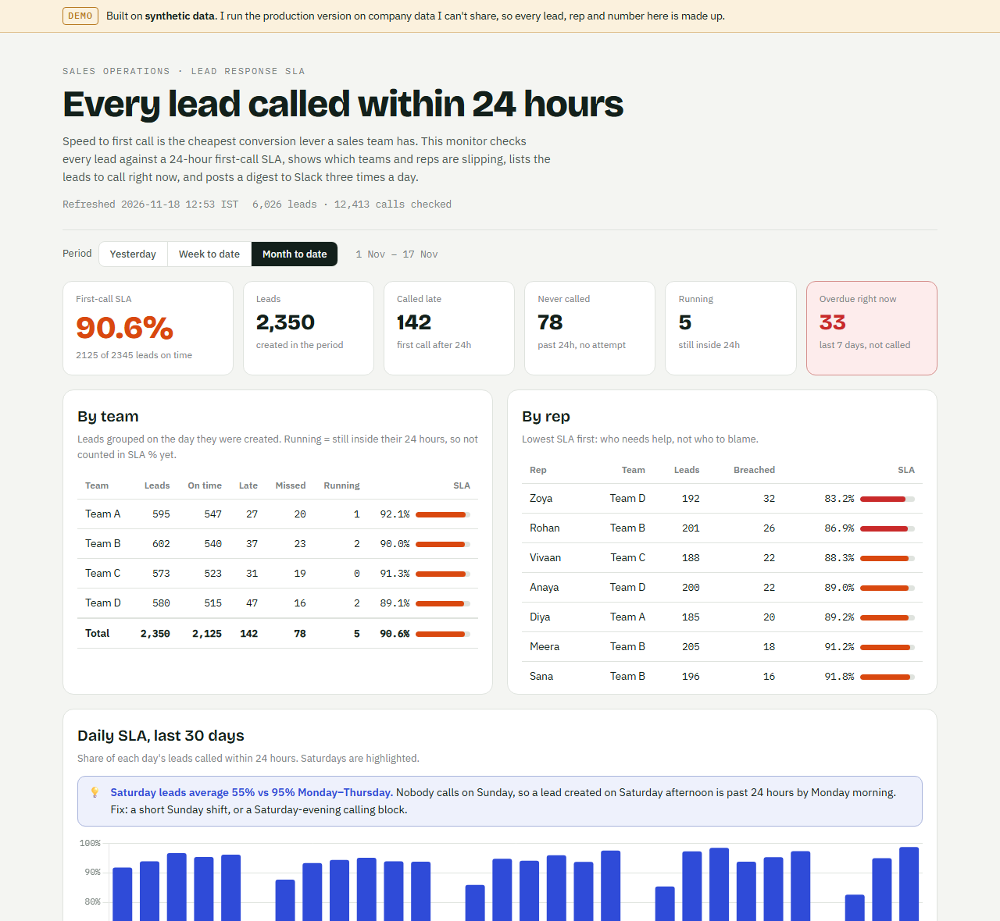

<div align="center">

# Lead SLA Monitor

**Every lead called within 24 hours: SLA by team and rep, a call-now list, and a Slack digest three times a day.**

[](https://nikhilveerwani.github.io/lead-sla-monitor/)
[](https://github.com/nikhilveerwani/lead-sla-monitor/actions/workflows/refresh.yml)


<a href="https://nikhilveerwani.github.io/lead-sla-monitor/"></a>

</div>

> **Demo with synthetic data.** I built and run the production version of this alert for a sales team, on company data I can't share. This repo is a clean-room rebuild: fresh code, made-up leads and reps, the same rules. It also includes a **Google Sheets template you can use on your own data**.

## The problem

Speed to first call is the cheapest conversion lever a sales team has, and it decays quietly. Nobody notices a lead that was never called. The team sees "calls made", not "leads missed". A weekly report arrives too late to save any of them.

The team needed three things:

1. **A number everyone agrees on:** the share of leads that got a first call within 24 hours, by team and by rep.
2. **A list, not a chart:** the exact leads that are overdue right now, and the ones about to breach.
3. **To be told, not to go looking:** a digest in the team's Slack channel at 10:00, 14:00 and 19:00.

## What's in the repo

| Path | What it is |
|---|---|
| [`apps-script/`](apps-script/) | **The template.** `Code.gs` + `sla_core.js` for a Google Sheet: builds an SLA summary tab and a breached-leads tab with a Reason dropdown, and posts to Slack on a schedule. Setup takes about 10 minutes: [SETUP.md](apps-script/SETUP.md). Sample CSVs included. |
| [`apps-script/sla_core.js`](apps-script/sla_core.js) | **All the SLA rules, in one file.** The same file runs in Apps Script, in the tests and in the demo build, so the three can't disagree. |
| [`tests/`](tests/) | 14 tests. 9 cover the rules (deadlines, timezone, period boundaries, pre-creation calls). 5 run `Code.gs` against an in-memory fake of Google Sheets (tabs, persisted reasons, edit stamps, Slack post, no post on Sundays). |
| [`pipeline/`](pipeline/) | Synthetic data generator (Python) and the report builder (Node), which feed the live demo. |
| [`site/`](site/) | The demo report: a static page rebuilt by GitHub Actions at the same three times a day. |

## The rules (and why)

- **SLA = the first call *attempt* within 24 clock hours of the lead being created.** Attempts, not connects: this SLA measures speed, and connect rate is a separate metric.
- **Calls logged before the lead was created are ignored.** They belong to an earlier registration of the same person, and counting them would make a missed lead look on time.
- **Leads still inside their 24 hours are "Running" and excluded from SLA %.** Otherwise yesterday's number always looks bad in the morning.
- **Periods follow the lead's creation date in the business timezone:** yesterday (D-1), Monday to yesterday (WTD), and the 1st to yesterday (MTD).
- **The team's reasons survive every refresh.** The breached tab is rebuilt on each run, but Reason and Comment are stored by lead ID in a hidden tab and written back. Editing them stamps who and when.

## What the demo surfaces

The made-up data is shaped like the real problem, so the report has something to find. For example, **Saturday leads land around 50% SLA against 95% on weekdays**. Nobody calls on Sunday, so a lead created on Saturday afternoon is past 24 hours by Monday morning. The page detects this automatically and suggests the fix.

## Run it locally

```bash
node --test tests/*.test.js
python pipeline/generate_synthetic.py --out data --days 45
node pipeline/build_report.js data site/data.js
# open site/index.html
```

It needs Node 18+ and Python 3.10+, with no packages to install.

---

<sub>Built by <a href="https://nikhilveerwani.github.io/">Nikhil Veerwani</a> · Analytics, BI &amp; Growth · All data in this repository is synthetic.</sub>
